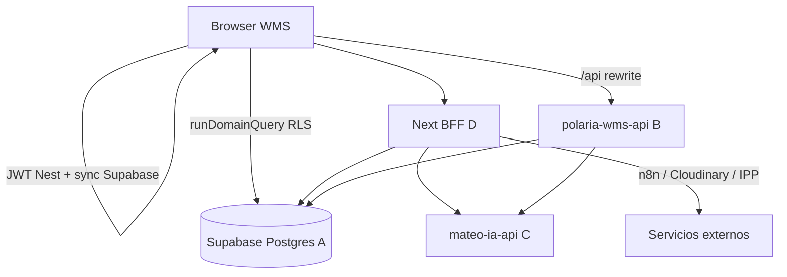

# Arquitectura de comunicación WMS (web ↔ backends)

Documento de frontera **oficial** del producto. Describe **cómo habla hoy** el front y **qué canal debe usarse** en trabajo nuevo, **sin cambiar** las reglas de negocio ya en producción.

Repos relacionados: `polaria-wms-web`, `polaria-wms-api`, `polaria-wms-db`, `mateo-ia-api`.

---

## 1. Canales (leyenda)

| Código | Canal | Quién ejecuta | Uso típico |
|--------|--------|---------------|------------|
| **A** | Supabase (Postgres + RLS) | Browser con JWT sync, o Next con service role | Lecturas tenant, listados, maestros, mutaciones ligeras ya existentes |
| **B** | Nest `polaria-wms-api` | Browser vía rewrite `/api/*` → `NEXT_PUBLIC_API_BASE_URL`; SSR directo al host | Transacciones de negocio, side-effects, integraciones, OT/jobs |
| **C** | `mateo-ia-api` | Solo servidor (BFF Next o Nest) | Lectura IA de pedidos / relectura correo |
| **D** | BFF Next (`app/api/*` u otras rutas server) | Node de Next | Secretos, Storage, impresión, n8n, Cloudinary, orquestación IA |

**Auth:** login y JWT viven en **B** (Nest). Tras login, el web **sincroniza** sesión a Supabase Auth para que **A** respete RLS (`AuthProvider` / `auth.store`).

---

## 2. Regla de frontera (para trabajo nuevo)

1. **Lecturas de tablas tenant con RLS** → **A** (`runDomainQuery` / cliente browser), salvo que ya exista un endpoint Nest estable y el módulo ya lo use en exclusiva (p. ej. operaciones).
2. **Mutaciones de negocio con side-effects** (emitir, cancelar, OT, correos de ingreso, transporte, recepción, locks de inventario) → **B**.
3. **Secretos, Storage, impresión IPP/SMTP, webhooks n8n, Cloudinary, OpenAI en captura** → **D** (nunca exponer claves al browser).
4. **IA de pedidos en UI OV** → **D** orquesta catálogo (**A** admin) + **C**.  
   **IA en corrección / relectura OV** → **B** (Nest → **C**). No llamar `mateo-ia-api` desde el browser.
5. **Esquema, RLS, triggers, migraciones** → `polaria-wms-db` (no duplicar reglas en tres sitios).
6. **No mover** un flujo de A→B o B→A “por limpieza” sin ticket + tests: la frontera se aplica en **código nuevo** y en migraciones **acordadas**.

**Híbrido intencional (no es deuda a “borrar” de golpe):** el producto **debe** seguir usando A+B+D(+C). Congelar el mapa de la §4; solo migrar un flujo con ticket + tests. Contrato ejecutable en código: `src/lib/architecture/wms-channels.ts`.

Prioridad si un día se consolida: **órdenes de venta** → mutaciones críticas en **B**, listados/detalle liviano en **A**, preservando RLS y locks.

---

## 3. Cómo llega el browser a Nest

- Cliente: `getApiBaseUrl()` → `/api/...` (`src/config/env.ts`, `src/services/api/api.ts`).
- `next.config.ts` reescribe la mayoría de `/api/:path*` a Nest.
- Exclusiones explícitas del rewrite (BFF local **D**):  
  `pedido-proveedor`, `solicitud-compra`, `evidencia-transporte`, `product-version`,  
  `ventas/leer-pedido`, `ventas/imprimir-orden`, `ventas/productos-catalogo`,  
  `ventas/ordenes/:id/log`, `reportes/*`.
- Otros BFF por filesystem (no van a Nest): `ov-adjuntos/*`, `ventas/cuenta-auto-imprimir`, `operaciones/sync-demora-alertas`, más rutas fuera de `/api` (`captura-orden/.../api`, `despacho/api`, `reportes-embed/*`, `login/resolve-tenant`).

Módulos Nest cableados en `AppModule`: Auth, Configurator, Configuracion, Integration, Purchases, Inventory, Operations, Processing, Sales, Transport, MateoWidget (+ core config/db/security/guards).

---

## 4. Mapa por dominio (estado actual = contrato operativo)

| Dominio | Flujo | Canal hoy | Objetivo / nota |
|---------|--------|-----------|-----------------|
| **Auth** | prelogin, login, `/auth/me`, SSO Mateo, widget token | **B** (+ sync **A**) | Mantener. Prelogin BFF **D**+admin OK |
| **Dashboard** | Conteos widgets | **A** | Mantener lecturas en **A** |
| **Sales — OV** | Listado, detalle, borrador, precios, stock, locks, materializar | **A** (+ **B** emitir/cancelar/list API) | **Prioridad:** no romper; nuevo código de side-effects en **B**; lecturas siguen **A** |
| **Sales — OT / corrección / reagrupar / dividir** | Jobs y propuestas | **B** (Nest→**C** si IA) | Mantener en **B** |
| **Sales — correos** | Lista, ingreso, adjuntos | **B** | Mantener en **B** |
| **Sales — leer pedido IA** | Multipart → catálogo → mateo | **D**→**A**+**C** | Mantener orquestación en **D**; no usar controller Nest duplicado desde web |
| **Sales — catálogo venta** | Matchers / picker | **D**→**A** admin | Mantener |
| **Sales — impresión / log / adjuntos** | PDF, IPP, Storage, auditoría | **D**→**A** admin | Mantener en **D** |
| **Sales — captura surtido QR** | Foto → OpenAI → persistencia | **D** (+ OpenAI, no **C**) | Mantener fuera de `/api` rewrite |
| **Sales — despacho público** | Confirmación sin shell | **D**→**A** admin | Mantener |
| **Purchases** | Lecturas SOL/OC | **A** | Mantener lecturas **A** |
| **Purchases** | Crear/emitir/aprobar/recepción | **B** | Mantener escrituras **B** |
| **Purchases — n8n** | Webhooks SOL / pedido proveedor | **D** | Mantener |
| **Inventory** | `warehouse_state` lectura | **A** | Mantener |
| **Inventory** | Lock/unlock, movimientos | **B** | Mantener |
| **Warehouses — estado bodega** | Zonas, slots, ubicaciones | **A** | Mantener |
| **Warehouses — demora / reportes** | Sync alertas; reportes mixtos | **D**/**A** + **B** parcial | Mantener; no fusionar a ciegas |
| **Transport** | Listados | **A** | Mantener |
| **Transport** | Paquetes / entregas / evidencia | **B** / **D** (foto) | Mantener |
| **Processing** | Listados y create/cierre solo **B** (exige cuenta+bodega) | **B** | Sin listado legacy sin scope (`PROCESSING_CHANNEL_CONTRACT`) |
| **Sales — surtido QR** | Sync estado OV por fotos | **D** calcula → **B** escribe | `POST …/avanzar-estado-surtido` + `INTERNAL_API_KEY`; ver ADR-004 |
| **Operations** | OT, tareas, alertas, reportes API | **B** | Mantener solo **B** |
| **Configurator** | Empresas/usuarios/bodegas (mixto) | **A**+**B** | Lecturas **A**; altas/bootstrap **B** |
| **Configurator — cuentas / impresoras** | Zona, SLA, queries | **A** (+ **D** impresión) | Mantener |
| **Admin-panel** | Catálogo, maestros, MIT | **A** | Mantener |
| **Admin-panel — usuarios cuenta** | Lista **A**; CRUD **B** | Mantener |
| **Admin-panel — reportes embed** | Grants + Mateo URL | **D**→**A** | Mantener |
| **Audit** | `auditoria_operacion` | **A** | Mantener |
| **Mateo widget** | Token + conversaciones | **B** (+ script CDN) | No confundir con **C** |
| **Versión producto** | SemVer UI | **D** | `product-version` local |

---

## 5. Diagrama (vista rápida)

---

## 6. Órdenes de venta (detalle de prioridad)

Hoy OV es el dominio más híbrido (y el más importante):

| Acción | Canal |
|--------|--------|
| Listar / filtrar / badges listado | **A** (y a veces list Nest con fallback) |
| Crear/editar borrador, materializar, locks presencia | **A** |
| Emitir / cancelar | **B** |
| Correos, OT, reagrupar, dividir, corrección | **B** |
| Leer pedido (Mateo) | **D** + **C** |
| Imprimir / adjuntos / log | **D** |

**No se migra en bloque** en este cambio. Cualquier movimiento futuro debe preservar: estados OV, locks de edición, materialización, impresión, correo no enviado, Cypher/OT y RLS de cuenta.

---

## 7. Checklist para un ticket nuevo

1. ¿Es lectura tenant con RLS? → **A** (salvo módulo ya 100 % Nest).  
2. ¿Tiene side-effect / integración / job? → **B** o **D**.  
3. ¿Necesita secreto o Storage? → **D**.  
4. ¿Es IA de documento de pedido? → **D**/**C** o Nest→**C**, nunca browser→**C**.  
5. ¿Cambia esquema o RLS? → migración en `polaria-wms-db`.

---

## 8. Fuente de verdad pedidos / IA (paso 5)

| Capacidad | Dueño canónico | Otros repos |
|-----------|----------------|-------------|
| Lectura IA de pedidos / documentos | **mateo-ia-api** | Nest solo orquesta (`MateoIaClient`); web BFF `ventas/leer-pedido` → Mateo |
| Reconciliación / relectura con instrucción | **mateo-ia-api** | Nest: `orden-correo-relectura.mateo` → Mateo; no reimplementar en Nest |
| Texto origen / chrome correo (servidor) | **mateo-ia-api** | — |
| Texto origen / materialize / match catálogo (UI) | **polaria-wms-web** `ordenes/utils/origen/*` y `match/*` | Un solo path (sin barrels compat en `utils/`) |
| Parse/group `origen_correo` para DB/respuestas Nest | Nest `ai/utils/origen-correo-*` (alineado a Mateo) | Web tiene superset UI en `origen/` |

**Regla:** no copiar de nuevo `pedido-ia-documentos`, `texto-origen-pedido` ni reconciliación local en Nest. Si hace falta lógica IA → endpoint en Mateo.

**SSOT web (P1):** barrels `Compat re-export` de la raíz de `ordenes/utils/` viven en `ordenes/utils/_archived/` (no reimportar). Gate: `ordenes-utils-ssot.architecture.test.ts`. Hash parity Nest↔Mateo: `mateo-ai-utils-sync` en CI de API (y e2e-stack).

## 9. Qué no hace este documento

- No reescribe servicios ni mueve endpoints de negocio.  
- No invalida el comportamiento actual: el mapa de la §4 **es** el contrato operativo.
